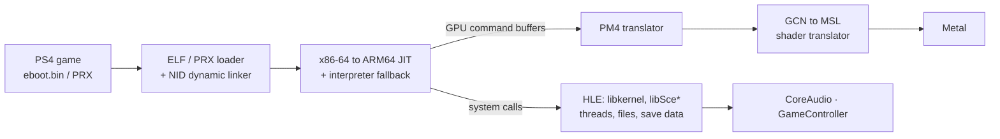

# orbis-on-macos

**Run PS4 games natively on Apple Silicon Macs.** A from-scratch, clean-room PS4 runtime: it recompiles the game's x86-64 code to ARM64 on the fly and translates its GPU shaders straight to Metal, without Rosetta, Vulkan, MoltenVK or a virtual machine.

[](https://github.com/nacimoualla/orbis-on-macos/actions/workflows/ci.yml)
[](LICENSE)
[](#requirements)
[](https://github.com/nacimoualla/orbis-on-macos/stargazers)

<!-- A 10-second GIF of a game running goes here: it is the single biggest thing a visitor looks for. -->

## What runs today

| Game | Status | Notes |
|---|---|---|
| **Flappy Bird** (Unity, `NPXX51362`) | 🟢 Playable | Real Mono runtime (`mono-ps4.prx`), full game loop at a steady 60 fps. |
| **Dragon Ball Xenoverse 2** (`CUSA05350`) | 🟡 Menus | Boots, logos, opening movie at 50–60 fps, save-data dialog, precautions and EULA screens. Main menu not reached yet. |
| **Sonic Mania Plus** (`CUSA07010`) | 🟢 Playable | Runs, at about 60 fps. |

🟢 playable · 🟡 partly working · 🔴 doesn't boot. This is an early project: expect most other titles not to boot yet. Reports are welcome as [issues](https://github.com/nacimoualla/orbis-on-macos/issues).

## Why it's different

- **Native ARM64 JIT.** Guest x86-64 code, including SSE/AVX, is translated to ARM64 blocks that chain directly into each other. In Flappy Bird about 99% of executed instructions run as native code. Every instruction form is checked against real x86 hardware by a differential test suite (1,350+ encodings, run under Rosetta 2).
- **GCN shaders straight to Metal.** The PS4's GPU shader bytecode is translated to Metal Shading Language at runtime, with no SPIR-V or Vulkan layer in between. Constant data that every pixel would otherwise re-read is evaluated once per draw.
- **Built for unified memory.** The 8 GB guest address space is mapped directly into the Mac's memory, which the CPU and the GPU share.
- **High-level emulation of the OS.** Calls into PS4 system libraries are answered by native code, so no Sony firmware or system modules are needed.



## Quick start

Requirements: a Mac with Apple Silicon, the Xcode Command Line Tools and CMake 3.25 or later. Intel Macs are not supported.

```bash
git clone https://github.com/nacimoualla/orbis-on-macos.git
cd orbis-on-macos
cmake -B build -DCMAKE_BUILD_TYPE=Release
cmake --build build -j
```

Run a game you own (put it under `games/`, which git ignores):

```bash
./build/ps4-runner --window --budget 0 games/<Title>/eboot.elf
```

Unity titles ship their scripting runtime as PRX modules; add `PS4_LOAD_PRX=1` to run them for real:

```bash
PS4_LOAD_PRX=1 ./build/ps4-runner --window --budget 0 games/<Title>/eboot.elf
```

**Controls:** `Space`, `Enter`, `↑`, `→` or a left click press Cross and the touch pad. `Esc` closes the window. Add `PS4_FLIP_STATS=1` to print fps once a second, or `MTL_HUD_ENABLED=1` for Apple's Metal HUD.

| Option | Meaning |
|---|---|
| `--window`, `-w` | Open a window and present at 60 Hz. |
| `--budget N` | Stop after N guest instructions; `0` means unlimited (use it for games). |
| `--no-jit` | Interpreter only (slow; for debugging). |
| `--headless` | No window (default). |
| `--trace`, `-t` | Trace every guest instruction. |

## Roadmap

The runtime foundation is done: loader, memory, JIT, linker, HLE, file system, Metal pipeline, audio and threads. The current work moves more retail titles from "boots" to "playable": broader system-library coverage, more GPU features and shader instructions, and performance. See [ROADMAP.md](ROADMAP.md) and the [Next-Up board (#1)](https://github.com/nacimoualla/orbis-on-macos/issues/1).

## Developing

```bash
cd build && ctest --output-on-failure      # 31 headless test targets
scripts/x86_diff/run.sh                    # interpreter and JIT vs real x86 hardware
```

- [docs/DEVELOPMENT.md](docs/DEVELOPMENT.md): running Unity titles, the test suites, the off-Mac CPU harness, NID auditing and JIT coverage tools.
- [docs/agents/debug-switches.md](docs/agents/debug-switches.md): every debug switch, including GPU frame capture, Xcode Metal captures, a JIT-compatible write watch and frame-triggered actions.
- [docs/adr/](docs/adr/): architecture decision records. [GLOSSARY.md](GLOSSARY.md): Orbis, GNM, NID, PRX, HLE and other terms.

For profiling and debugging, build with `-DCMAKE_BUILD_TYPE=Investigate` (`-O2` with assertions on).

## Contributing

Contributions are welcome: see [CONTRIBUTING.md](CONTRIBUTING.md) and the [Next-Up board (#1)](https://github.com/nacimoualla/orbis-on-macos/issues/1). The quickest way to help is to try a game you own and open an issue with the log. This is a clean-room project: never commit Sony code, keys, firmware, system modules (`*.prx`, `*.sprx`), packages (`*.pkg`), `eboot.bin` files or game content.

## Related projects

**[shadPS4](https://github.com/shadps4-emu/shadPS4)** is the leading cross-platform PS4 emulator (Windows, Linux, macOS, FreeBSD), built on Vulkan; for the widest game support today, start there. orbis-on-macos takes a Mac-first route: native ARM64 code and Metal end to end.

## Legal

This project is a clean-room reimplementation of the documented userland interfaces of the PS4's operating system. It contains no Sony source code, firmware, keys, system modules or game content, and it does not enable piracy: you must supply your own legally obtained games. "PlayStation", "PS4" and "Orbis" are trademarks of Sony Interactive Entertainment; this project is not affiliated with or endorsed by Sony.

## Support

If this project helps you, you can [buy me a coffee](https://buymeacoffee.com/ouallanacim).

## License

[MIT](LICENSE). Provided "as is", without warranty of any kind.
